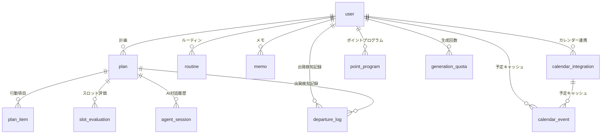

# データベース定義書（PostgreSQL 版）

- 状態：承認済み（2026-11-10）
- 元資料：`docs/Alli/DB定義書.txt`（原本・変更しない）に、`docs/design/db-additional-columns.md`（WBS 2.11、判断事項 D1〜D11）を反映したもの
- DDL（`server/drizzle/`）とスキーマ定義（`server/src/db/schema.ts`）は、この定義書を正とする

## 1. データベース基本情報

| 項目 | 内容 |
| --- | --- |
| DBMS | PostgreSQL 16（開発・本番は Aurora Serverless v2、ローカルは `postgres:16`） |
| 文字コード | UTF-8 |
| タイムゾーン | DB のパラメータは `Asia/Tokyo`。日時は `timestamptz` で保存し、日付（`date`）は日本時間の日付を入れる |
| スキーマ | `public`（マイグレーションの適用履歴は `drizzle.__drizzle_migrations`） |

### 共通の決まり

- 主キーは `integer GENERATED ALWAYS AS IDENTITY`（`user` と `generation_quota` を除く）。
- 利用者の識別子は Cognito の sub（`varchar(64)`）。`user.id` と各テーブルの `user_id` は同じ型（D2）。
- 全テーブルに `created_at`・`updated_at`（`timestamptz NOT NULL DEFAULT now()`）を持つ（`generation_quota` は `updated_at` のみ）。`updated_at` は更新時にアプリが設定する（トリガーは使わない）。
- 論理削除（`is_deleted`・`deleted_at`）と作成者・更新者列は持たない。削除は物理削除（D4〜D6）。
- 選択肢の値は API と同じ英字コードで保存し、CHECK 制約で制限する（D8）。
- 外部キーはすべて `ON DELETE CASCADE`。退会（`user` の行の削除）で、その利用者のデータがすべて消える（D4）。
- `user` は PostgreSQL の予約語のため、SQL を手で書くときは `"user"` と二重引用符で囲む。

## 2. テーブル定義

### 2.1 user（ユーザー）

システムを利用する一般利用者。認証の正本は Cognito で、メールアドレスは DB に持たない（D3）。

| カラム名 | 論理名 | データ型 | NULL | デフォルト | 説明 |
| --- | --- | --- | --- | --- | --- |
| id | 利用者ID | varchar(64) | NO | - | PRIMARY KEY。Cognito の sub |
| home_address | 自宅住所 | varchar(255) | YES | NULL | オンボーディング完了前は未設定 |
| home_latitude | 自宅緯度 | double precision | YES | NULL | |
| home_longitude | 自宅経度 | double precision | YES | NULL | |
| frequently_used_stations | よく使う駅 | jsonb | NO | `'[]'` | `[{ stationCode, stationName, label }]`、最大20件 |
| walking_speed | 徒歩速度 | varchar(10) | NO | `'normal'` | CHECK: slow / normal / fast |
| preparation_time_minutes | 準備時間（分） | integer | NO | 30 | CHECK: 0〜180 |
| priority_condition | 優先条件 | varchar(20) | NO | `'on_time'` | CHECK: on_time / save_money / points |
| memo_usage_consent | メモ利用同意 | boolean | NO | false | |
| location_usage_consent | 位置情報利用同意 | boolean | NO | false | |
| calendar_usage_consent | カレンダー予定利用同意 | boolean | NO | false | |
| notification_enabled | 通知設定 | boolean | NO | false | |
| onboarding_completed | オンボーディング完了 | boolean | NO | false | API の onboardingCompleted |
| terms_accepted_at | 利用規約の同意日時 | timestamptz | YES | NULL | API の termsAcceptedAt |
| created_at | 作成日時 | timestamptz | NO | now() | |
| updated_at | 更新日時 | timestamptz | NO | now() | |

### 2.2 plan（行動計画）

家を出てから帰宅までの行動計画。確認質問は最大2回。

| カラム名 | 論理名 | データ型 | NULL | デフォルト | 説明 |
| --- | --- | --- | --- | --- | --- |
| id | 一意識別子 | integer | NO | IDENTITY | PRIMARY KEY |
| user_id | 利用者ID | varchar(64) | NO | - | FOREIGN KEY → user.id |
| input_text | 用事入力テキスト | varchar(500) | NO | - | 最大500文字 |
| target_date | 対象日 | date | NO | - | 計画の対象日（日本時間）。API の targetDate |
| departure_time | 出発時刻 | timestamptz | YES | NULL | 生成中・確認質問中は未確定 |
| return_time | 帰宅時刻 | timestamptz | YES | NULL | 同上 |
| status | 状態 | varchar(20) | NO | `'generating'` | CHECK: generating / clarifying / completed / error |
| clarification_count | 確認質問回数 | integer | NO | 0 | CHECK: 0〜2 |
| clarification_question | 確認質問 | varchar(255) | YES | NULL | 確認質問中のみ |
| assumptions | 仮定した内容 | jsonb | NO | `'[]'` | 文字列の配列 |
| warnings | 注意 | jsonb | NO | `'[]'` | 文字列の配列 |
| created_at | 作成日時 | timestamptz | NO | now() | |
| updated_at | 更新日時 | timestamptz | NO | now() | |

### 2.3 plan_item（行動項目）

行動計画を構成する個々の行動（移動・立寄り・用事など）。買う品目（purchaseItems）は保存しない。

| カラム名 | 論理名 | データ型 | NULL | デフォルト | 説明 |
| --- | --- | --- | --- | --- | --- |
| id | 一意識別子 | integer | NO | IDENTITY | PRIMARY KEY |
| plan_id | 行動計画ID | integer | NO | - | FOREIGN KEY → plan.id |
| sequence | 順序 | integer | NO | - | |
| slot_type | スロット種別 | varchar(20) | NO | - | CHECK: DEPARTURE / OUTBOUND / MAIN / RETURN |
| item_type | 項目種別 | varchar(20) | NO | - | CHECK: departure / move / stopover / errand / meal / return |
| title | 見出し | varchar(100) | NO | - | タイムラインの見出し |
| start_time | 開始時刻 | timestamptz | NO | - | |
| end_time | 終了時刻 | timestamptz | NO | - | |
| location_name | 場所名 | varchar(255) | YES | NULL | |
| location_latitude | 場所緯度 | double precision | YES | NULL | |
| location_longitude | 場所経度 | double precision | YES | NULL | |
| transport_mode | 移動手段 | varchar(10) | YES | NULL | CHECK: walk / bicycle / car / train（バスは対象外。D7） |
| route_detail | ルート詳細 | jsonb | YES | NULL | `{ distanceMeters, durationMinutes, fareYen, polyline, steps[] }` |
| store | 立寄り先の店舗 | jsonb | YES | NULL | `{ placeId, name, address, pointProgramCode }` |
| station_exit | 駅出口 | varchar(255) | YES | NULL | |
| boarding_position | 乗車位置 | varchar(255) | YES | NULL | |
| description | 説明 | varchar(500) | YES | NULL | |
| created_at | 作成日時 | timestamptz | NO | now() | |
| updated_at | 更新日時 | timestamptz | NO | now() | |

### 2.4 slot_evaluation（スロット評価）

行動計画テンプレートの各スロットの評価結果（AI がスロットの検討を省略していないことの記録）。

| カラム名 | 論理名 | データ型 | NULL | デフォルト | 説明 |
| --- | --- | --- | --- | --- | --- |
| id | 一意識別子 | integer | NO | IDENTITY | PRIMARY KEY |
| plan_id | 行動計画ID | integer | NO | - | FOREIGN KEY → plan.id |
| slot_type | スロット種別 | varchar(20) | NO | - | CHECK: DEPARTURE / OUTBOUND / MAIN / RETURN |
| slot_name | スロット名 | varchar(255) | NO | - | |
| evaluation_order | 評価順序 | integer | NO | - | |
| is_evaluated | 評価済みフラグ | boolean | NO | - | |
| evaluation_result | 評価結果 | varchar(1000) | YES | NULL | |
| created_at | 作成日時 | timestamptz | NO | now() | |
| updated_at | 更新日時 | timestamptz | NO | now() | |

### 2.5 agent_session（AI対話履歴）

AI とのやり取りの要約と判定結果（プロンプト全文は保存しない）。

| カラム名 | 論理名 | データ型 | NULL | デフォルト | 説明 |
| --- | --- | --- | --- | --- | --- |
| id | 一意識別子 | integer | NO | IDENTITY | PRIMARY KEY |
| plan_id | 行動計画ID | integer | NO | - | FOREIGN KEY → plan.id |
| session_type | セッション種別 | varchar(20) | NO | - | CHECK: intent（意図解析）/ clarify（確認質問）/ compose（行動計画組立）/ replan（再計画） |
| input_summary | 入力要約 | varchar(1000) | NO | - | |
| output_summary | 出力要約 | varchar(1000) | NO | - | |
| judgment_result | 判定結果 | varchar(1000) | YES | NULL | |
| created_at | 作成日時 | timestamptz | NO | now() | |
| updated_at | 更新日時 | timestamptz | NO | now() | |

### 2.6 routine（ルーティン）

利用者が定期的に行う行動。単発スキップは「スキップした日」で持つ（D9）。

| カラム名 | 論理名 | データ型 | NULL | デフォルト | 説明 |
| --- | --- | --- | --- | --- | --- |
| id | 一意識別子 | integer | NO | IDENTITY | PRIMARY KEY |
| user_id | 利用者ID | varchar(64) | NO | - | FOREIGN KEY → user.id |
| routine_name | ルーティン名 | varchar(255) | NO | - | |
| location_name | 場所 | varchar(255) | YES | NULL | |
| start_time | 開始時刻 | time | YES | NULL | 時刻のみ。CHECK: 両方 NULL、または start_time < end_time |
| end_time | 終了時刻 | time | YES | NULL | 同上 |
| skipped_date | スキップした日 | date | YES | NULL | 日本時間。「skipped_date = 今日」のとき skippedToday |
| created_at | 作成日時 | timestamptz | NO | now() | |
| updated_at | 更新日時 | timestamptz | NO | now() | |

### 2.7 memo（メモ）

付箋形式のメモ。作成から1週間で自動削除（物理削除）する。

| カラム名 | 論理名 | データ型 | NULL | デフォルト | 説明 |
| --- | --- | --- | --- | --- | --- |
| id | 一意識別子 | integer | NO | IDENTITY | PRIMARY KEY |
| user_id | 利用者ID | varchar(64) | NO | - | FOREIGN KEY → user.id |
| memo_text | メモ本文 | varchar(255) | NO | - | 自然文・箇条書き・絵文字可 |
| checked_lines | チェック済み行 | jsonb | NO | `'[]'` | 行番号（整数）の配列 |
| created_at | 作成日時 | timestamptz | NO | now() | |
| updated_at | 更新日時 | timestamptz | NO | now() | |

### 2.8 calendar_integration（カレンダー連携）

Google Calendar／Outlook との連携設定。トークン本体は Secrets Manager に置く（D11）。未連携は行なし、解除時は行を削除する。

| カラム名 | 論理名 | データ型 | NULL | デフォルト | 説明 |
| --- | --- | --- | --- | --- | --- |
| id | 一意識別子 | integer | NO | IDENTITY | PRIMARY KEY |
| user_id | 利用者ID | varchar(64) | NO | - | FOREIGN KEY → user.id |
| provider | プロバイダー | varchar(10) | NO | - | CHECK: google / outlook |
| status | 連携状態 | varchar(20) | NO | `'connected'` | CHECK: connected / error |
| secret_name | シークレット名 | varchar(255) | NO | - | Secrets Manager の名前（例：`integration/{user_id}/google`）。API には出さない |
| scope | 許可されたスコープ | varchar(255) | YES | NULL | |
| connected_at | 連携日時 | timestamptz | NO | now() | API の connectedAt |
| last_synced_at | 最終同期日時 | timestamptz | YES | NULL | API の lastSyncedAt |
| last_error | 直近のエラー | varchar(255) | YES | NULL | 内部用 |
| created_at | 作成日時 | timestamptz | NO | now() | |
| updated_at | 更新日時 | timestamptz | NO | now() | |

### 2.9 calendar_event（カレンダー予定キャッシュ）

カレンダー予定の当日分のキャッシュ。連携を解除すると一緒に消える。

| カラム名 | 論理名 | データ型 | NULL | デフォルト | 説明 |
| --- | --- | --- | --- | --- | --- |
| id | 一意識別子 | integer | NO | IDENTITY | PRIMARY KEY |
| user_id | 利用者ID | varchar(64) | NO | - | FOREIGN KEY → user.id |
| calendar_integration_id | カレンダー連携ID | integer | NO | - | FOREIGN KEY → calendar_integration.id |
| external_event_id | 外部イベントID | varchar(255) | NO | - | |
| event_title | 予定件名 | varchar(255) | NO | - | |
| event_date | 予定の日付 | date | NO | - | 日本時間。当日分のみ保持・削除バッチ用 |
| is_all_day | 終日予定 | boolean | NO | false | |
| start_time | 開始時刻 | timestamptz | NO | - | |
| end_time | 終了時刻 | timestamptz | NO | - | |
| location | 場所 | varchar(255) | YES | NULL | |
| created_at | 作成日時 | timestamptz | NO | now() | |
| updated_at | 更新日時 | timestamptz | NO | now() | |

### 2.10 departure_log（出発検知記録）

出発検知の実績。Web 版では出発検知を行わないため、テーブルだけ用意する。

| カラム名 | 論理名 | データ型 | NULL | デフォルト | 説明 |
| --- | --- | --- | --- | --- | --- |
| id | 一意識別子 | integer | NO | IDENTITY | PRIMARY KEY |
| user_id | 利用者ID | varchar(64) | NO | - | FOREIGN KEY → user.id |
| plan_id | 行動計画ID | integer | NO | - | FOREIGN KEY → plan.id |
| planned_departure_time | 計画出発時刻 | timestamptz | NO | - | |
| actual_departure_time | 実際の出発時刻 | timestamptz | NO | - | |
| preparation_time_minutes | 準備時間（分） | integer | NO | - | |
| created_at | 作成日時 | timestamptz | NO | now() | |
| updated_at | 更新日時 | timestamptz | NO | now() | |

### 2.11 point_program（ポイントプログラム）

利用者が使うポイント制度。名称と店舗チェーンは共通の対応表（WBS 5.11 の設定ファイル）から引く。

| カラム名 | 論理名 | データ型 | NULL | デフォルト | 説明 |
| --- | --- | --- | --- | --- | --- |
| id | 一意識別子 | integer | NO | IDENTITY | PRIMARY KEY |
| user_id | 利用者ID | varchar(64) | NO | - | FOREIGN KEY → user.id |
| program_code | プログラムの識別子 | varchar(10) | NO | - | CHECK: rakuten / vpoint / dpoint / ponta / waon / nanaco |
| is_enabled | 有効フラグ | boolean | NO | true | |
| created_at | 作成日時 | timestamptz | NO | now() | |
| updated_at | 更新日時 | timestamptz | NO | now() | |

### 2.12 generation_quota（生成回数）

利用者×日付ごとの計画生成回数（上限20回。超えたら 429）。計画を削除しても回数が戻らないよう、計画とは別に持つ（D10）。数える API は WBS 5.9 で確定する。古い日付の行は日次バッチで削除する。

| カラム名 | 論理名 | データ型 | NULL | デフォルト | 説明 |
| --- | --- | --- | --- | --- | --- |
| user_id | 利用者ID | varchar(64) | NO | - | PRIMARY KEY（1）。FOREIGN KEY → user.id |
| quota_date | 日付 | date | NO | - | PRIMARY KEY（2）。日本時間の日付 |
| used_count | 生成回数 | integer | NO | 0 | その日に数えた回数 |
| updated_at | 更新日時 | timestamptz | NO | now() | |

## 3. インデックス・一意制約

主キーは省略。

| テーブル | 名前 | カラム | 種別 | 用途 |
| --- | --- | --- | --- | --- |
| plan | idx_plan_user_id_created_at | user_id, created_at | INDEX | 利用者別の履歴表示（原本の idx_plan_user_id を置き換え） |
| plan_item | idx_plan_item_plan_id_sequence | plan_id, sequence | INDEX | 計画別の時系列表示 |
| slot_evaluation | idx_slot_evaluation_plan_id_evaluation_order | plan_id, evaluation_order | INDEX | 計画別の評価順表示 |
| agent_session | idx_agent_session_plan_id | plan_id | INDEX | 計画別の絞り込み |
| routine | idx_routine_user_id | user_id | INDEX | 利用者別の絞り込み |
| memo | idx_memo_user_id_created_at | user_id, created_at | INDEX | 利用者別・作成日時順 |
| memo | idx_memo_created_at | created_at | INDEX | 自動削除バッチ（作成から1週間）の範囲検索 |
| calendar_integration | uq_calendar_integration_user_id_provider | user_id, provider | UNIQUE | 利用者・プロバイダーごとに1件 |
| calendar_event | idx_calendar_event_user_id | user_id | INDEX | 利用者別の絞り込み |
| calendar_event | uq_calendar_event_integration_external | calendar_integration_id, external_event_id, event_date | UNIQUE | 同じ予定の重複キャッシュを防ぐ |
| departure_log | idx_departure_log_user_id | user_id | INDEX | 利用者別の絞り込み |
| departure_log | idx_departure_log_plan_id | plan_id | INDEX | 計画別の絞り込み |
| point_program | uq_point_program_user_id_program_code | user_id, program_code | UNIQUE | 同じプログラムを二重登録しない |

原本にあった次の2つは、先頭カラムが同じ一意制約で代用できるため作らない。

- `idx_calendar_event_calendar_integration_id`（`uq_calendar_event_integration_external` で代用）
- `idx_point_program_user_id`（`uq_point_program_user_id_program_code` で代用）

## 4. 外部キー制約

| 制約名 | 子テーブル | 子カラム | 親テーブル | 親カラム | ON DELETE |
| --- | --- | --- | --- | --- | --- |
| fk_plan_user_id | plan | user_id | user | id | CASCADE |
| fk_plan_item_plan_id | plan_item | plan_id | plan | id | CASCADE |
| fk_slot_evaluation_plan_id | slot_evaluation | plan_id | plan | id | CASCADE |
| fk_agent_session_plan_id | agent_session | plan_id | plan | id | CASCADE |
| fk_routine_user_id | routine | user_id | user | id | CASCADE |
| fk_memo_user_id | memo | user_id | user | id | CASCADE |
| fk_calendar_integration_user_id | calendar_integration | user_id | user | id | CASCADE |
| fk_calendar_event_user_id | calendar_event | user_id | user | id | CASCADE |
| fk_calendar_event_calendar_integration_id | calendar_event | calendar_integration_id | calendar_integration | id | CASCADE |
| fk_departure_log_user_id | departure_log | user_id | user | id | CASCADE |
| fk_departure_log_plan_id | departure_log | plan_id | plan | id | CASCADE |
| fk_point_program_user_id | point_program | user_id | user | id | CASCADE |
| fk_generation_quota_user_id | generation_quota | user_id | user | id | CASCADE |

## 5. CHECK 制約

| 制約名 | テーブル | 条件 |
| --- | --- | --- |
| ck_user_walking_speed | user | walking_speed が slow / normal / fast |
| ck_user_preparation_time_minutes | user | preparation_time_minutes が 0〜180 |
| ck_user_priority_condition | user | priority_condition が on_time / save_money / points |
| ck_plan_status | plan | status が generating / clarifying / completed / error |
| ck_plan_clarification_count | plan | clarification_count が 0〜2 |
| ck_plan_item_slot_type | plan_item | slot_type が DEPARTURE / OUTBOUND / MAIN / RETURN |
| ck_plan_item_item_type | plan_item | item_type が departure / move / stopover / errand / meal / return |
| ck_plan_item_transport_mode | plan_item | transport_mode が NULL、または walk / bicycle / car / train |
| ck_slot_evaluation_slot_type | slot_evaluation | slot_type が DEPARTURE / OUTBOUND / MAIN / RETURN |
| ck_agent_session_session_type | agent_session | session_type が intent / clarify / compose / replan |
| ck_routine_time_range | routine | start_time と end_time が両方 NULL、または start_time < end_time |
| ck_calendar_integration_provider | calendar_integration | provider が google / outlook |
| ck_calendar_integration_status | calendar_integration | status が connected / error |
| ck_point_program_program_code | point_program | program_code が rakuten / vpoint / dpoint / ponta / waon / nanaco |

## 6. ER 図

## 7. マイグレーション

手順は `README.md` の「DB マイグレーション」を参照。

- スキーマ定義：`server/src/db/schema.ts`（Drizzle ORM）
- 適用する SQL：`server/drizzle/NNNN_<名前>.sql`（`npm run db:generate` で生成）
- 取り消す SQL：`server/drizzle/down/NNNN_<名前>.sql`（手で書く。`npm run db:rollback` で直近の1件を取り消す）
